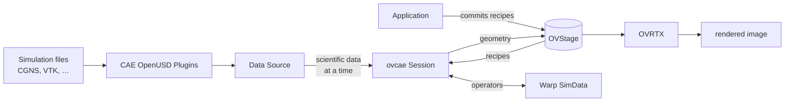

# OVCAE

OVCAE is an experimental library for building GPU-accelerated CAE
(computer-aided engineering) visualization workflows from native simulation
files or in-memory data. Generate surfaces, slices, streamlines, point clouds,
and glyphs in headless, desktop, or streamed applications while your application
controls the workflow and user experience. No Omniverse Kit SDK is required.

The [CAE OpenUSD Plugins][cae-plugins] access supported native formats such as
CGNS and VTK on demand, and [Warp SimData][warp-simdata] performs the computation.
OVCAE coordinates these steps and publishes the results into [OVStage][ovstage];
add [OVRTX][ovrtx] to render them. Simulation files remain in their native formats.

OVCAE uses *recipes* to make the visualization setup reusable. Each recipe is
an OpenUSD prim that records an operation, its data references, and its
parameters. Recipes can be saved, composed, edited, and evaluated against the
original data.

> **Experimental.** APIs, packaging, and dependencies may change. This branch
> does not yet match the functional coverage of [Kit-CAE][kit-cae]. For the
> Kit-based application and its build and launch instructions, use Kit-CAE.

## Current status

- **Six operators.** Faces, Points, Glyphs, Iso Surface, Planar Slice, and
  Streamlines run on the GPU. See the [operator reference](docs/operators.md).
- **Updates you drive.** Evaluate asynchronously and inspect each operator's
  status and diagnostics before committing the output. Results can be reused
  when their inputs and committed products are known to be unchanged.
- **Data from more than one place.** Scientific datasets in their native
  formats through the CAE OpenUSD Plugins, in-memory arrays, and Data Sources
  you write yourself, all in the same pipeline.
- **Operators you write.** Declare the inputs and schema properties they need,
  register them, and use the same execution and publication lifecycle.
- **Recipe authoring** on usd-core stages: builders, controls, typed schema
  classes, validation, and material wiring. The schema bundle and the MDL
  material library are importable resources.
- **Reference workflows** for headless processing, an OVUI desktop, and
  OVStream browser viewing, plus a fuller CAE Viewer application.

What isn't there yet:

- NVIDIA IndeX, XAC, and Flow are out of scope for now.
- Color ranges are not computed for you; a recipe supplies its own
  `color_range`.
- No automatic scientific playback or file watching; applications select the
  time or publish new in-memory data for each update.

## How it fits together

OVCAE publishes `Mesh`, `BasisCurves`, `Points`, or `PointInstancer` geometry
at each recipe's prim path in OVStage. OVRTX renders it with the bundled CAE
materials and colormaps. For a file-backed rendering application, the libraries
compose as follows:



| Library | What it does here |
| --- | --- |
| **[CAE OpenUSD Plugins][cae-plugins]** | OpenUSD schemas and on-demand access to supported native scientific data, without a prerequisite conversion step. |
| **[Warp SimData][warp-simdata]** | Accelerated processing across supported data models through shared interfaces, built on NVIDIA Warp. |
| **[OVStage][ovstage]** | Shared runtime scene state: the committed recipes going in, the computed geometry coming out. |
| **[OVRTX][ovrtx]** | RTX rendering of the committed scene, including the bundled CAE MDL materials. |
| **[OVUI][ovui]** | Standalone user interface components for the desktop examples. |
| **[OVStream][ovstream]** | Streaming rendered frames and receiving camera input for browser viewing. |

Native files remain the source of truth. Saved scenes hold references and
recipes; evaluation generates the geometry in OVStage as needed.

The application commits recipe edits and asks a `Session` to evaluate them.
The input ordinal specifies a minimum committed publication, not a historical
snapshot; keep inputs unchanged until evaluation finishes. The Session leases
scientific data at the requested time and writes results at the chosen output
ordinal. It never commits the stage. The application can commit directly or
use `ovcae.app.UpdateLoop` to manage updates and commits on its behalf.

## What is in the package

All subpackages are installed together. Imports are layered: `import ovcae`
loads only the standard library, while runtime dependencies are loaded when
used. Extras add dependencies for native-data access and streaming.

| Package | Use it to |
| --- | --- |
| `ovcae` | Evaluate recipes with `Session`, connect Data Sources, and register custom operators |
| `ovcae.readers` | Read native scientific files through the CAE OpenUSD Plugins; requires the `usd` extra |
| `ovcae.authoring` | Create and edit recipe scenes on usd-core stages |
| `ovcae.schemas` | Access the codeless OmniCaeViz schema bundle and typed schema classes |
| `ovcae.materials` | Access the bundled MDL materials and colormap textures |
| `ovcae.app` | Manage interactive updates and commits with `UpdateLoop` |
| `ovcae.stream` | Render and stream frames to a browser with `LiveView`; requires the `stream` extra and OVRTX |

The [package reference](docs/packages.md) lists public APIs and import behavior;
the [installation guide](docs/installation.md) lists dependencies and extras.

## Getting started

Use Linux x86-64 with CPython 3.12, an RTX-capable NVIDIA GPU, and a compatible
driver. The desktop and streaming examples use OVRTX for GPU rendering.

Install this experimental branch from source with [uv](https://docs.astral.sh/uv/):

```console
git clone https://github.com/NVIDIA-Omniverse/kit-cae.git
cd kit-cae
git checkout experimental-ovcae
uv sync --frozen --no-dev
```

`uv sync` creates `.venv` using the checked-in lockfile. Add `--extra usd` to
read native scientific files. See [installation](docs/installation.md) for
extras, dependency ranges, and setup order.

### Evaluate your first recipe

The [getting-started tutorial](docs/getting-started.md) authors a Points recipe,
evaluates three in-memory points on the GPU, and commits the result. It uses
the base install above and does not need a simulation file.

### Try a desktop workflow

The [minimal OVUI example](examples/ovui-minimal/README.md) opens a CGNS file,
displays an iso-surface, and lets you edit, save, and reopen the scene. The
[CAE Viewer](examples/cae-viewer/README.md) provides a viewport with picking, transform
gizmos, undo, and evaluation-status annotations. To try its bundled scene, run from the
repository root after installing [Git LFS](https://git-lfs.com/):

```console
git lfs pull
cd examples/cae-viewer
uv sync --frozen
uv run --no-sync app.py assets/scene.usda
```

The viewer keeps its own environment inside that directory, so this works from
the same checkout. Point it at your own `.usda` instead, or start it with no
filename and use **Open USD…**. It needs an RTX-capable GPU, and the first
launch spends a few minutes compiling shaders.

### Embed it in an application

This example evaluates an existing `scene.usda` containing recipes and native
data references. It requires the `usd` extra and the GPU environment described
above. The [getting-started tutorial](docs/getting-started.md) shows how to
author a scene from scratch.

```python
import ovcae
import ovcae.readers
import ovstage

# Register schemas and readers before creating a stage.
ovcae.setup()
time_seconds = 0.0

# Populate the application's stage, including recipe properties.
stage = ovstage.Stage("my-app")
ovstage.population.open_usd_with_desc(
    stage,
    "scene.usda",
    ordinal=1,
    time_code=0.0,
    descs=ovcae.ovstage_population_desc(domains=ovstage.PopulationDomain.RENDERING),
)
stage.advance_write_floor(1).wait()

# Resolve scientific arrays and publish generated geometry into OVStage.
with (
    ovcae.readers.UsdDataSource.open("scene.usda") as data_source,
    ovcae.Session(stage, device="cuda:0") as session,
):
    input_ordinal, output_ordinal = 1, 2

    # Keep the lease and recipe inputs stable until wait() returns.
    with data_source.at_time(time_seconds) as frame_data:
        report = session.update(
            input_ordinal=input_ordinal,
            output_ordinal=output_ordinal,
            frame_data=frame_data,
        ).wait()

    # A committable report can still contain individual operator failures.
    for diagnostic in report.diagnostics:
        print(f"[{diagnostic.severity}] {diagnostic.operator_path}: {diagnostic.message}")

    # Publish coherent output for consumers such as a renderer.
    if report.committable:
        stage.advance_write_floor(output_ordinal).wait()
```

When adding OVRTX, register its schemas before `ovcae.setup()` and create the
renderer before populating OVStage. See the [integration guide](docs/integration-guide.md)
for rendering and interactive updates.

## Tutorials and examples

See [Examples and tutorials](docs/examples-and-tutorials.md) for the
application examples and tutorial learning sequence. The
[tutorials README](tutorials/README.md) covers notebook setup, execution,
and contribution conventions.

## Documentation

Start here:

- [Installation](docs/installation.md): prerequisites, extras, dependency
  ranges, and the initialization order your process has to follow.
- [Getting started](docs/getting-started.md): create and evaluate your first
  scene.
- [Examples and tutorials](docs/examples-and-tutorials.md): application
  examples and a learning sequence for using and extending OVCAE.

Then, depending on what you are building:

- [Integration guide](docs/integration-guide.md): the update and commit
  cycle, Data Sources, reports, change detection, and who owns what between
  your application and OVCAE.
- [Authoring guide](docs/authoring-guide.md): recipe builders,
  controls, materials and colormaps, typed schema editing, and the schema
  registry.
- [Operators](docs/operators.md): what the built-in operators do and where
  their limits are, and how to write, register, and test your own.
- [Readers](docs/readers.md): read datasets in their native formats with
  `ovcae.readers`, and package a reader for a representation of your own.

For reference:

- [Packages and public API](docs/packages.md): what each subpackage is for,
  what importing it does, and what it exports.
- [Troubleshooting](docs/troubleshooting.md): diagnostics and known
  environment issues.
- [Release notes](CHANGELOG.md): user-visible capabilities and compatibility
  changes.

## Contributing

This project is currently not accepting contributions.

## Feedback and support

Report problems through the project's [GitHub issues][issues]. Include the
commit tested, the versions of OVStage, Warp SimData, and the CAE OpenUSD
Plugins in your environment, and steps to reproduce the issue.

This is experimental work provided as-is, without a support SLA.

## License

The software and materials are governed by the [NVIDIA Software License Agreement](https://www.nvidia.com/en-us/agreements/enterprise-software/nvidia-software-license-agreement/) and the [Product Specific Terms for NVIDIA AI Products](https://www.nvidia.com/en-us/agreements/enterprise-software/product-specific-terms-for-ai-products/).

Kit-CAE's reference license copies ship as [LICENSE.md](LICENSE.md) and
[PRODUCT_TERMS_OMNIVERSE](PRODUCT_TERMS_OMNIVERSE). See [NOTICE.md](NOTICE.md)
for third-party attributions.

This project will download and install additional third-party open source software projects. Review the license terms of these open source projects before use.

[kit-cae]: https://github.com/NVIDIA-Omniverse/kit-cae
[cae-plugins]: https://github.com/NVIDIA-Omniverse/cae-openusd-plugins
[warp-simdata]: https://github.com/NVIDIA/warp-simdata
[ovstage]: https://github.com/NVIDIA-Omniverse/ovstage
[ovrtx]: https://github.com/NVIDIA-Omniverse/ovrtx
[ovui]: https://github.com/NVIDIA-Omniverse/ovui
[ovstream]: https://github.com/NVIDIA-Omniverse/ovstream
[issues]: https://github.com/NVIDIA-Omniverse/kit-cae/issues
