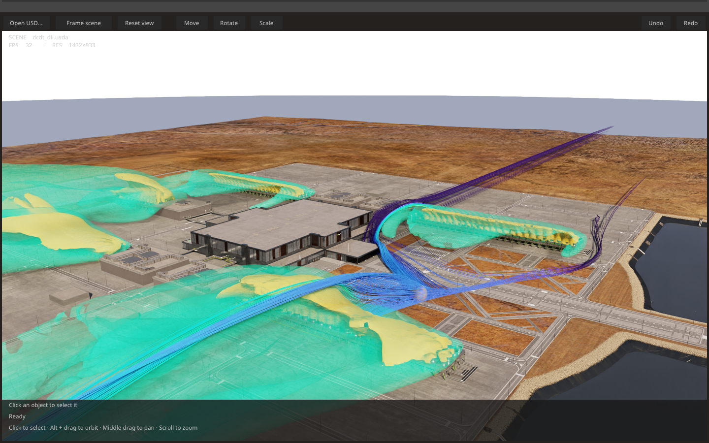

# CAE Viewer

A standalone OVUI application that opens USD files, renders them with OVRTX,
and lets you manipulate scene prims with viewport gizmos. Moving a streamline
seed re-evaluates its dependent CAE operators. Open your own recipe scene or
start with the bundled example.



*Data Center Digital Twin demo; the scene and its datasets are not bundled with this example.*

## Run

You need Linux x86-64, Python 3.12, an RTX-capable NVIDIA GPU and driver, and
[`uv`](https://docs.astral.sh/uv/). Clone Kit-CAE's `experimental-ovcae` branch
as described in the [installation guide](../../docs/installation.md).
From the repository root:

```console
git lfs pull
cd examples/cae-viewer
uv sync --frozen
uv run --no-sync app.py assets/scene.usda
```

Run the remaining commands from `examples/cae-viewer`.
Pass your own recipe scene in place of `assets/scene.usda` to view it.

Without a filename, the app starts empty. **Open USD…** opens a path-entry
dialog. To load the bundled example, enter `assets/scene.usda`. `.usd` and `.usdc` also work.
Opening another file replaces the current scene and discards its in-memory
edits. A failed open leaves the current scene intact. The app never saves or
overwrites the source file. First launch may take minutes to compile RTX shaders.
The app registers the bundled CAE material library before creating the
renderer, so scenes binding `cae/mdl/basic.mdl` materials render as authored.

## View and manipulate

The app has one viewport and a compact toolbar. It reuses OVUI's camera navigation,
picking, transform gizmos, undo, and FPS/resolution HUD. The lower annotation shows
the selected prim, evaluation status, and errors. Hover over a truncated status
for its full message; errors also appear in the terminal or `--log-file` trace.

- Click an object to select it. Shift + click adds to the selection, Ctrl + click
  removes from it, dragging a rectangle selects the enclosed objects, and clicking
  the background clears the selection. The renderer highlights selected meshes.
- Use **Move**, **Rotate**, or **Scale** to choose the gizmo. File-authored `Xform`
  and point-based prims accept transforms. Escape cancels a drag; **Undo** and
  **Redo** apply to transform edits. The buttons also work when the viewport has
  keyboard focus elsewhere.
- Alt + drag orbits, middle drag pans, and scrolling zooms.
- **Frame selection** fits visible geometry under the selected prims, preserving
  the viewing direction. **Frame scene**, or a selection without visible geometry,
  fits the whole scene. **Reset view** restores the saved file view when available,
  otherwise a framed overview, without clearing selection.

The viewer has no Stage Browser, property editor, or visibility controls. Hidden
and unpickable prims cannot be selected through a tree. Author operator parameters,
visibility, dataset/field selections, and materials in the USD file or a notebook
before opening it. Reload the file to discard transform edits.

Dragging buffers the latest transform while an OVCAE update runs, rather than
queuing every mouse event. The viewport presents the previous frame until the
new products are committed. A click during evaluation resolves when the next
committed frame answers its pick. **Updating…** describes CAE evaluation; the
native FPS counter describes viewport refresh and can include cached frames.
It does not measure solver or CAE evaluation throughput.

Selected-path validation uses file metadata captured once when opening the stage.
There is no per-frame hierarchy/visibility snapshot or hierarchy catch-up after
camera motion. Explicit framing can still wait for evaluation and read bounds.

Files saved from Kit open from their saved view. The viewer reads the root
layer's `cameraSettings` metadata: the `Perspective` position and target when
`boundCamera` is Kit's implicit perspective camera, or the composed transform,
focus distance, and aperture of a bound `Camera` prim in the file. Orthographic
Kit cameras and files without this metadata use the framed overview instead.
The viewer adds its own camera, render product, and (if absent) a dome light,
so the source file needs no specific camera, render setup, or prim paths.

Offscreen capture also requires an RTX-capable NVIDIA GPU:

```console
uv run --no-sync app.py assets/scene.usda --headless --frames 10 --screenshot /tmp/cae-viewer.png
```

Other launch options: `--width`, `--height`, `--fps`, `--device`. The GPU
selected with `--device cuda:N` is used for CAE compute and OVRTX rendering.
`--fps 0` (the default) disables application frame-rate limiting. Use a positive
value, such as `--fps 30`, to cap UI/render refreshes and reduce resource usage.
This does not change scientific time or operator integration settings; actual
throughput still depends on rendering cost and the display/backend.

## Files and time

Files are evaluated at time zero. Playback and live file watching are not
supported. Relative references and payloads retain their original layer anchors.
Runtime edits affect the execution Stage and are not saved to the source file.

The Linux OVUI environment includes a CUDA 12 runtime even on hosts with a CUDA
13 toolkit; use the locked viewer environment to install its dependencies.

See the [OVCAE documentation](../../README.md#documentation) for authoring recipes,
data sources, lifecycle rules, and troubleshooting.
