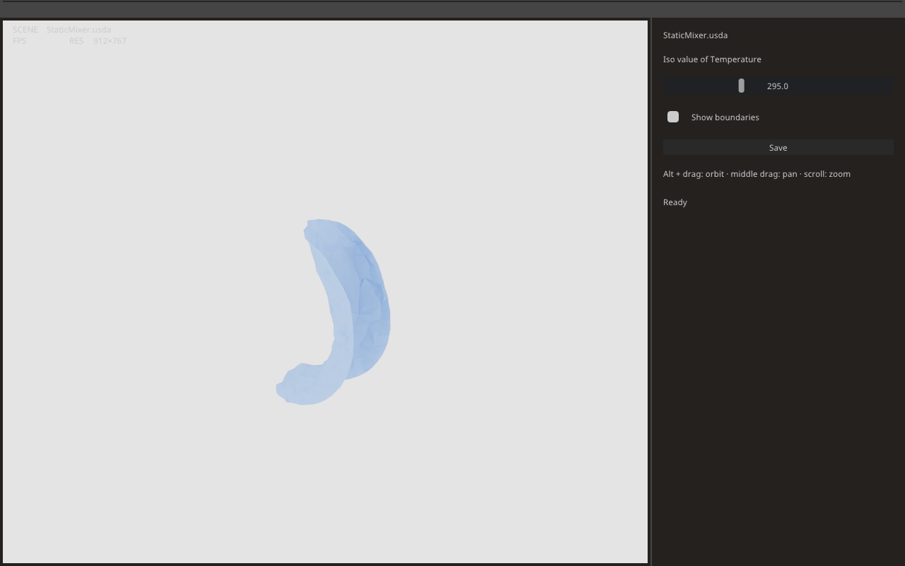

# Minimal OVUI desktop workflow

This small desktop application opens a CGNS file, authors the intent as
OpenUSD, evaluates it, and shows the result in an
[OVUI](https://pypi.org/project/ovui/) viewport rendered by OVRTX. One
slider moves an iso-surface, one checkbox shows the boundaries, and **Save**
writes the edits and the camera back into the scene. Reopen that scene and the
window recomputes the saved result.

Start with its two files, `workflow.py` and `app.py`, to see how the libraries
compose without Kit. The [CAE Viewer](../cae-viewer/README.md) adds transform
gizmos and picking.



*Bundled static-mixer dataset with the temperature iso value set to 295.*

## Run

You need Linux x86-64, Python 3.12, an RTX-capable NVIDIA GPU and driver,
and [`uv`](https://docs.astral.sh/uv/). Clone Kit-CAE's `experimental-ovcae`
branch as described in the [installation guide](../../docs/installation.md).
From the repository root:

```console
git lfs pull
cd examples/ovui-minimal
uv sync --frozen
uv run --no-sync app.py
```

Run the remaining commands from `examples/ovui-minimal`.

Without arguments the window opens the static-mixer dataset from
`tests/data`, authors `build/ovui-minimal/StaticMixer.usda` next to the
repository's other build output, and shows the temperature iso-surface. The
first launch compiles RTX shaders and can take minutes.

Pass your own file to start from it instead:

```console
uv run --no-sync app.py /path/to/result.cgns --dataset Fluid --field Pressure --scene /path/to/result.usda
```

`--dataset` names the dataset prim to contour and `--field` the field on it;
without them the example takes the first dataset in the file and its
`Temperature` field when it has one, else its first field. `--iso-value`
overrides the starting value, which is otherwise the middle of the field's
range. `--device cuda:N` selects the compute GPU and pins rendering to it.

## What the window does

The viewport is OVUI's stock widget. Alt + drag orbits, middle drag pans,
scrolling zooms. The panel on the right holds the workflow:

- **Iso value** moves the iso-surface. Each change is a recipe edit through
  `UpdateLoop.request`; the loop submits the latest value once the previous
  update commits, so dragging never queues more than one evaluation. The
  status line reports which operators recomputed.
- **Show boundaries** makes the Faces recipes for the other datasets visible.
  Visibility is a recipe edit too: a hidden recipe is not evaluated, so
  showing one checks whether its geometry needs an update.
- **Save** writes the iso value, the boundary visibility, and the camera into
  the scene file and shows the command that reopens it.

Camera moves never re-evaluate anything. The viewport hands the example a
view and a projection matrix each frame, and the example writes them to the
scene's camera as presentation edits through `UpdateLoop.write`.

## What the scene records

Open the saved `.usda` in an editor. It holds a payload to the CGNS file, an
iso-surface recipe with its field selections and colormap material, one
Faces recipe per boundary, a camera, a dome light, and a render product.
Generated geometry is not stored; reopening recomputes it from the native
data and saved intent. To reopen the default scene:

```console
uv run --no-sync app.py ../../build/ovui-minimal/StaticMixer.usda
```

The payload path is relative to the scene. Preserve that directory relationship
when moving the scene and dataset.

## How it is built

`workflow.py` knows nothing about OVUI. `author_scene` composes the file and
writes the recipes with `ovcae.authoring` and `ovcae.readers.import_dataset`.
`Workflow` owns the OVStage, the OVRTX renderer, and an
`ovcae.app.UpdateLoop`, and exposes the four things a window needs: recipe
edits, a render call that takes the viewport's camera, a pose to start from,
and `save`. `app.py` adds the window: a `RendererAdapter`
that forwards `render_frame` to the workflow, the controls, and a frame loop
that pumps the update loop, renders, and gives the OVCAE worker the GIL
while an evaluation runs.

Preserve the setup order when adapting the example:

- Register OVRTX's schemas, then call `ovcae.setup()` before creating stages
  or the renderer. Create the renderer before populating OVStage so it can
  resolve the bundled colormap textures.
- The workflow evaluates hidden boundaries once before attaching the renderer,
  then hides them again. This preserves their display colors with the pinned
  OVRTX build; hidden recipes retain their geometry.

## Headless runs and tests

Headless rendering also requires an RTX-capable NVIDIA GPU.

```console
uv run --no-sync app.py --headless --frames 12 --save --screenshot /tmp/minimal.png
```

`--headless` uses OVUI's offscreen Vulkan backend, `--frames` exits after that
many rendered frames, `--save` saves on exit as the button does, and
`--frame-dump out.npy` writes the last viewport frame for comparison. The
test file `tests/test_ovui_minimal_example.py` uses these to open the mixer,
change the iso value, save, reopen, and check that the reopened frame matches
the saved one and differs from a run at another iso value. Run it from this
directory so the window test finds OVUI:

```console
uv run --no-sync pytest ../../tests/test_ovui_minimal_example.py
```

The workflow round-trip test requires OVRTX and an RTX-capable NVIDIA GPU.
The window test also requires OVUI and is skipped in the library environment.
